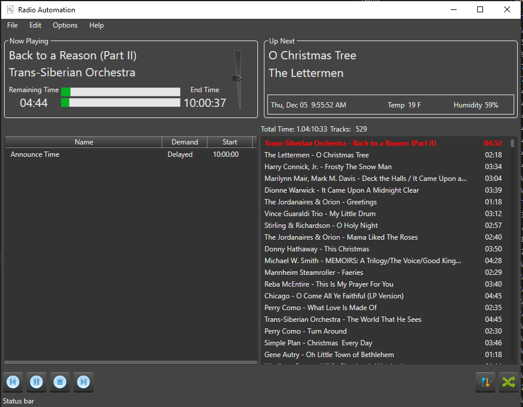

[](https://github.com/jeffu231/Radio-Automation/releases/latest)
[](https://github.com/jeffu231/Radio-Automation/releases/latest)
[](https://github.com/jeffu231/Radio-Automation/issues)

# Radio-Automation

Radio Automation is a purpose built audio player designed to be a off hours music player for my animated light display during the holidays. 



It plays a playlist built from files, folders, M3U playlists, Zara playlists or an internet stream. Cron-based or MQTT-triggered events can start, stop or interrupt playback and announce the time and temperature using Zara-style audio files.

## Documentation

Full documentation is in the [Wiki](https://github.com/jeffu231/Radio-Automation/wiki):

- [Getting Started](https://github.com/jeffu231/Radio-Automation/wiki/Getting-Started)
- [Playlists](https://github.com/jeffu231/Radio-Automation/wiki/Playlists)
- [Scheduler and Events](https://github.com/jeffu231/Radio-Automation/wiki/Scheduler-and-Events)
- [MQTT](https://github.com/jeffu231/Radio-Automation/wiki/MQTT)
- [Time and Temperature Files](https://github.com/jeffu231/Radio-Automation/wiki/Time-and-Temperature-Files)
- [Preferences](https://github.com/jeffu231/Radio-Automation/wiki/Preferences)
- [Weather](https://github.com/jeffu231/Radio-Automation/wiki/Weather)
- [Troubleshooting](https://github.com/jeffu231/Radio-Automation/wiki/Troubleshooting)

## Install

It is recommended to use the installer for the latest release. You can find it on the [latest release](https://github.com/jeffu231/Radio-Automation/releases/latest) page on GitHub.

Or via Winget installer.

```ps
winget install JTDev.RadioAutomation
```

More info on Winget can be found here: [Winget Installer](https://docs.microsoft.com/en-us/windows/package-manager/winget/)

## Support

While there is no formal support for this software, you can open an issue on GitHub if you find a bug or have a question.

### License

Software is released under the GPL v3 and is free to use under those terms.
